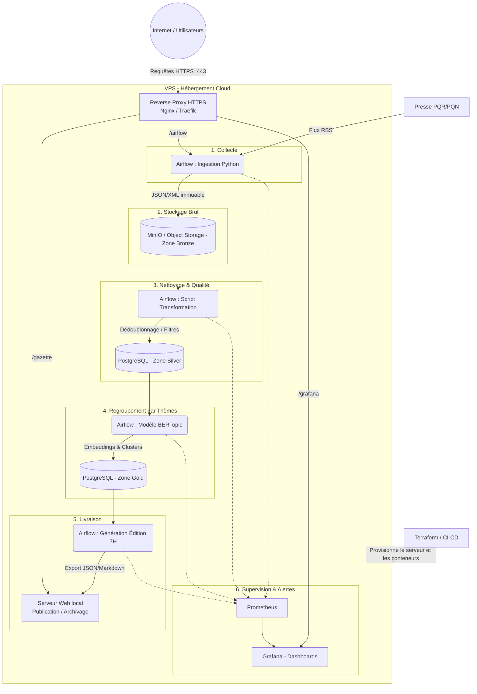

# Architecture du Projet : La Gazette

Ce document décrit l'architecture technique du pipeline de données de *La Gazette*. L'ensemble de la stack est conteneurisé (Docker) et hébergé sur un Serveur Privé Virtuel (VPS). L'exposition publique est sécurisée via un reverse proxy gérant les certificats SSL (HTTPS).

## 1. Schéma d'Architecture Cible

## 2. Description des Composants

### Infrastructure et Sécurité

* **VPS (Virtual Private Server) :** L'hôte distant exécutant le moteur Docker.
* **Reverse Proxy (Traefik / Nginx) :** Point d'entrée unique de notre infrastructure. Il gère la terminaison SSL (HTTPS) et route le trafic public entrant vers les interfaces spécifiques selon le chemin demandé (ex: `/airflow`, `/grafana`). Les bases de données (PostgreSQL, MinIO) ne sont pas exposées sur Internet et restent confinées dans le réseau privé Docker.
* **Terraform :** Outil d'Infrastructure as Code (IaC) exécuté en dehors du VPS (depuis un poste local ou un pipeline CI/CD) pour provisionner la machine et configurer les règles de sécurité réseaux.

### Pipeline de Données (Architecture Médaillon)

* **Orchestration (Airflow) :** Planifie et pilote les graphes de dépendances (DAGs) de l'ensemble du workflow quotidien, avec gestion native des alertes et des reprises sur erreur.
* **Zone Bronze (MinIO) :** Stockage objet agissant comme un Data Lake interne. Les flux RSS de la presse (PQR/PQN) y sont déposés sous forme de fichiers bruts immuables (JSON/XML).
* **Zone Silver (PostgreSQL) :** Stockage relationnel des articles structurés. Les scripts de nettoyage lisent la zone Bronze, filtrent les doublons, standardisent le format, et insèrent les données propres dans la base SQL.
* **Zone Gold (PostgreSQL + BERTopic) :** Modélisation et enrichissement. Le modèle de Machine Learning BERTopic vectorise les textes (embeddings) et les regroupe sémantiquement par thèmes. Les métadonnées enrichies sont stockées dans les tables finales.
* **Livraison :** Une tâche Airflow compile les thèmes majeurs du jour et déploie le résumé de 7H sur le serveur web intégré pour consultation.

### Observabilité

* **Prometheus :** Scrape (collecte) en continu les métriques du matériel (CPU, RAM) et des applications (temps de run Airflow, volumes ingérés).
* **Grafana :** Exploite les données de Prometheus pour fournir des tableaux de bord interactifs et déclencher des alertes automatiques en cas de rupture du SLA (édition non disponible à 7H).
