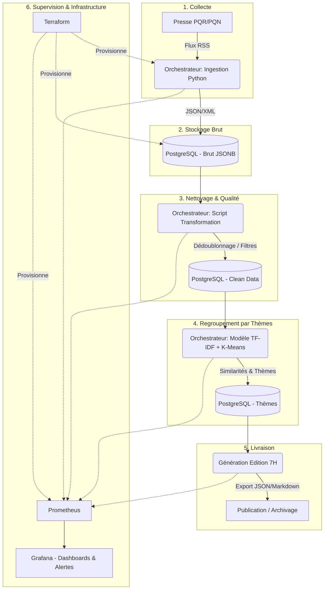

# TD 1 : Cadrage et Bornage - Projet La Gazette

## 1. Note de cadrage (`cadrage.md`)

### Le Besoin

Mettre en œuvre un pipeline de données automatisé capable de lire quotidiennement les publications de la presse quotidienne (PQR et PQN), d'en extraire les informations clés, et de produire à 7h précises une gazette thématique regroupant les sujets majeurs des dernières 24 heures. Ce processus doit être observable, testable et entièrement scripté.

### Périmètre (In / Out)

- **In (Inclus) :** Extraction des métadonnées (titres, dates, URL, courts extraits) via les canaux publics (flux RSS), nettoyage des doublons, regroupement thématique automatisé (ML), supervision (logs/métriques), infrastructure as code.
- **Out (Exclu) :** Scraping du contenu intégral des articles, récupération des images, aspiration des commentaires lecteurs, traitement de données à caractère personnel (RGPD), conception d'interfaces graphiques complexes (Front-end avancé).

### Contraintes

- **Techniques & Opérationnelles :** SLA de livraison à 7h00 (heure locale). Fraîcheur des données : traitement des articles publiés dans les 24h précédentes.
- **Financières :** Budget alloué de 0€ (utilisation des ressources locales au départ, puis de l'infra fournie).
- **Éthiques :** Respect strict des conditions d'utilisation des éditeurs de presse.

### Stack Technologique Retenue

*Suite à notre veille technique, la stack a été affinée pour correspondre à nos choix architecturaux :*

- **Collecte & Traitement :** Python (Robuste, standard data/ML) ciblant les flux RSS.
- **Ordonnancement (CI/CD) :** Orchestrateur Data (type Prefect, Dagster ou Airflow) pour la gestion avancée des graphes de dépendances et des reprises sur erreur.
- **Stockage :** Base de données relationnelle unique (PostgreSQL) gérant à la fois les données brutes (via le type `JSONB`) et les données propres et transformées.
- **Machine Learning :** NLP classique avec TF-IDF et K-Means (frugal, exécutable sur CPU, sans coût d'API).
- **Supervision :** Prometheus & Grafana (Standard de facto, intégration Docker optimale, alertes).
- **Infrastructure :** Terraform (IaC pour le provisionnement) & Docker / Docker Compose (socle applicatif).

### Risques Identifiés

1. **Indisponibilité des sources :** Changement d'URL ou coupure des flux RSS par un éditeur. *Mitigation : Gestion robuste des exceptions (`try/except`) et alertes sur la collecte.*
2. **Dérive du temps d'exécution :** Le pipeline ML prend plus de temps que prévu, manquant la deadline de 7h. *Mitigation : Monitoring strict du temps d'inférence via Prometheus.*
3. **Échec silencieux du pipeline :** Une tâche plante la nuit sans déclencher de relance. *Mitigation : Utilisation d'un véritable orchestrateur data plutôt qu'un simple cron.*

---

## 2. Choix Technologiques et Veille (Architecture Retenue vs Alternatives Écartées)

Dans le cadre du cadrage de La Gazette, nous avons évalué deux options pour chacun des six axes techniques du pipeline de données. Nos choix privilégient la simplicité opérationnelle, l'observabilité, et le respect strict de nos contraintes (budget zéro, pas de données personnelles, SLA à 7h).

### 2.1. Récupérer la presse

* **Notre choix : Flux RSS (Option B)**
  * *Pourquoi ce choix :* C'est le format standard, officiel et structuré proposé par les éditeurs pour une lecture automatisée. Il garantit la récupération du titre, du lien, de la date de publication et d'un court extrait de manière fiable. Surtout, cette méthode respecte nativement les conditions générales d'utilisation des sites de presse, sans frôler la légalité.
* **Alternative écartée : Web Scraping complet (Option A)**
  * *Pourquoi on l'écarte :* Le scraping massif du DOM (via BeautifulSoup ou Selenium) est fragile car la moindre mise à jour graphique du site casse le pipeline. De plus, récupérer le texte intégral s'oppose à notre contrainte juridique et éthique, avec un risque élevé de blocage de nos adresses IP.

### 2.2. Faire tourner chaque matin

* **Notre choix : Orchestrateur Data type Airflow / Prefect / Dagster (Option B)**
  * *Pourquoi ce choix :* Un pipeline de données de production ne tolère pas les échecs silencieux. Un orchestrateur nous offre une vue claire sous forme de graphe (DAG), gère nativement les reprises sur erreur (*retries*), l'ordre des dépendances, et nous prévient si la gazette n'est pas prête avant 7h.
* **Alternative écartée : Script Bash automatisé via un simple Cron (Option A)**
  * *Pourquoi on l'écarte :* Un Cron classique manque cruellement d'observabilité. S'il échoue à 5h du matin à cause d'une coupure réseau, la tâche "meurt" sans repêchage, et le débogage à posteriori nécessite d'aller fouiller manuellement dans des logs textuels non structurés.

### 2.3. Stocker

* **Notre choix : Base de données relationnelle unique - PostgreSQL (Option A)**
  * *Pourquoi ce choix :* Pour notre volume de métadonnées (titres, dates, résumés), une base de données relationnelle moderne comme PostgreSQL est amplement suffisante. Elle gère d'ailleurs parfaitement les données semi-structurées grâce à son type `JSONB` pour stocker le brut, tout en assurant l'intégrité du stockage propre (dédoublonnage via contraintes SQL).
* **Alternative écartée : Data Lake + Data Warehouse séparés (Option B)**
  * *Pourquoi on l'écarte :* La mise en place d'un stockage objet (S3) couplé à un entrepôt de données introduirait une complexité architecturale disproportionnée (*over-engineering*) par rapport à nos besoins actuels et augmenterait la surface de maintenance sans gain direct de performance pour du simple texte.

### 2.4. Regrouper des textes

* **Notre choix : Machine Learning classique - TF-IDF + K-Means (Option A)**
  * *Pourquoi ce choix :* Cette approche traditionnelle de traitement du langage naturel (NLP) est extrêmement rapide, frugale en ressources (tourne sur un simple CPU) et répond parfaitement à notre contrainte de budget zéro. Elle suffit largement pour calculer des similarités lexicales et regrouper les articles parlant du même sujet du jour.
* **Alternative écartée : Modèles de Langage (LLM) via API ou Embeddings lourds (Option B)**
  * *Pourquoi on l'écarte :* Appeler une API externe (type OpenAI) enfreindrait notre contrainte de budget zéro et créerait une dépendance externe bloquante. Héberger de gros modèles d'embeddings (Sentence-Transformers) en local exigerait des ressources matérielles (RAM/GPU) dont nous ne disposons pas au démarrage du projet.

### 2.5. Surveiller

* **Notre choix : Stack Prometheus & Grafana**
  * *Pourquoi ce choix :* C'est le standard incontournable de l'observabilité moderne. Prometheus "scrappe" nos métriques techniques (durée du pipeline, nombre d'articles ingérés) de manière très légère. Grafana nous permet de construire un tableau de bord visuel et de configurer des alertes automatisées (ex: alerte Slack si l'édition de 7h n'est pas prête).
* **Alternative écartée : Stack ELK (Elasticsearch, Logstash, Kibana) ou logs bruts**
  * *Pourquoi on l'écarte :* La stack ELK, bien que très puissante pour la recherche textuelle dans les logs, est extrêmement gourmande en mémoire et en CPU (infrastructure lourde). Se contenter de simples logs sans métriques, à l'inverse, nous rendrait "aveugles" sur la santé globale du pipeline.

### 2.6. Décrire l'infrastructure en code

* **Notre choix : Terraform**
  * *Pourquoi ce choix :* Terraform est purement déclaratif et gère l'état (`state`) de l'infrastructure. Il nous permet de décrire de manière idempotente l'intégralité de nos besoins (conteneurs, bases de données, réseaux), ce qui est vital pour la reproductibilité exigée par la compétence C8.2.
* **Alternative écartée : Scripts d'automatisation Bash / Ansible**
  * *Pourquoi on l'écarte :* L'écriture de scripts manuels engendre rapidement de la "dérive de configuration" (configuration drift) et n'est pas idempotente. Ansible, bien qu'excellent pour configurer l'intérieur des serveurs existants, est moins pertinent que Terraform pour le provisionnement d'infrastructures initiales dans une approche Cloud/Conteneur.

---

## 3. Dictionnaire des sources (`sources.csv`)

| nom             | type | region                              | acces   | conditions                                      | notes                           |
| :-------------- | :--- | :---------------------------------- | :------ | :---------------------------------------------- | :------------------------------ |
| Ouest-France    | PQR  | Bretagne/Normandie/Pays de la Loire | URL RSS | Pas de scraping intégral, usage non commercial | Fréquence de MàJ élevée     |
| La Voix du Nord | PQR  | Hauts-de-France                     | URL RSS | Usage informatif court                          | Sections par villes disponibles |
| Sud Ouest       | PQR  | Nouvelle-Aquitaine                  | URL RSS | Maintien du lien hypertexte original            | -                               |
| Le Télégramme | PQR  | Bretagne                            | URL RSS | Extraits uniquement                             | -                               |
| Le Monde        | PQN  | National                            | URL RSS | Pas d'archivage massif abusif                   | Flux très riche et structuré  |
| Libération     | PQN  | National                            | URL RSS | Citation de la source obligatoire               | -                               |
| Le Figaro       | PQN  | National                            | URL RSS | Respect des balises XML                         | -                               |
| Les Échos      | PQN  | National                            | URL RSS | Ne pas contourner le paywall                    | Orienté économie/business     |

*(Note : Fichier à générer au format `.csv` à la racine ou dans le dossier `data/` du dépôt de l'équipe).*

---

## 4. Architecture Cible (Mermaid)

