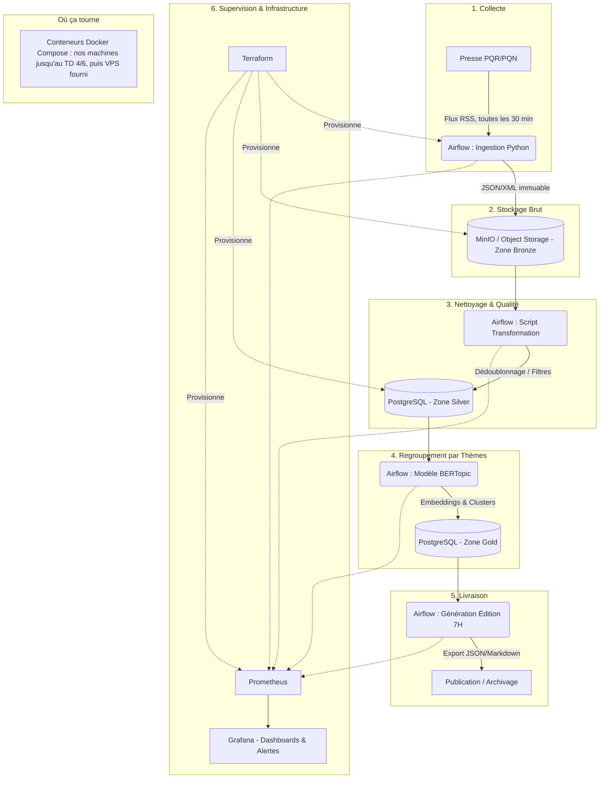

# TD 1 : Cadrage et Bornage - Projet La Gazette

## 1. Note de cadrage (`cadrage.md`)

### Le Besoin

Mettre en œuvre un pipeline de données automatisé capable de lire quotidiennement les publications de la presse quotidienne (PQR et PQN), d'en extraire les informations clés, et de produire à 7h précises une gazette thématique regroupant les sujets majeurs des dernières 24 heures. Ce processus doit être observable, testable et entièrement scripté.

### Périmètre (In / Out)

- **In (Inclus) :** Extraction des métadonnées (titres, dates, URL, courts extraits) via les canaux publics (flux RSS), nettoyage des doublons, regroupement thématique automatisé (ML), supervision (logs/métriques), infrastructure as code.
- **Out (Exclu) :** Scraping du contenu intégral des articles, récupération des images, aspiration des commentaires lecteurs, traitement de données à caractère personnel (RGPD), conception d'interfaces graphiques complexes (Front-end avancé).

### Contraintes

- **Techniques & Opérationnelles :** Livraison à 7h00 (heure locale). Fraîcheur des données : traitement des articles publiés dans les 24h précédentes.
- **Financières :** Budget alloué de 0€ : nos machines (Docker Compose) jusqu'au TD 4/6, puis l'infrastructure de production fournie (VPS).
- **Collecte :** nos mesures du 20/10 montrent que certains flux ne gardent que quelques heures d'actualité (Ouest-France : 10 items, soit ~30 min ; Le Figaro, Sud Ouest, L'Humanité : ~4 h). Une seule lecture le matin raterait la majorité des articles : la collecte tourne donc **toutes les 30 min**, les items s'accumulent dans la zone Bronze, et l'édition est générée à partir des articles des dernières 24 h.
- **Éthiques :** Respect strict des conditions d'utilisation des éditeurs de presse.

### Stack Technologique Retenue

*Suite à notre veille technique, la stack a été affinée pour correspondre à nos choix architecturaux :*

- **Collecte & Traitement :** Python (Robuste, standard data/ML) ciblant les flux RSS.
- **Ordonnancement :** Orchestrateur Data (Airflow) : un DAG de collecte toutes les 30 min, un DAG d'édition (nettoyage, thèmes, livraison) avant 7 h, avec reprises sur erreur.
- **Stockage :** Architecture médaillon hybride combinant un Object Storage (ex: MinIO ou stockage de fichiers local) pour la zone Bronze (données brutes immuables) et PostgreSQL pour les zones Silver (données propres) et Gold (thèmes générés).
- **Machine Learning :** Modélisation thématique sémantique avec BERTopic (embeddings légers `all-MiniLM-L6-v2` + UMAP/HDBSCAN, exécutable sur CPU sans dépendance ni coût d'API).
- **Supervision :** Prometheus & Grafana (Standard de facto, intégration Docker optimale, alertes).
- **Infrastructure :** Terraform (IaC pour le provisionnement) & Docker / Docker Compose (socle applicatif).

### Risques Identifiés

1. **Indisponibilité des sources :** Changement d'URL ou coupure des flux RSS par un éditeur. *Mitigation : Gestion robuste des exceptions (`try/except`) et alertes sur la collecte.*
2. **Dérive du temps d'exécution :** Le pipeline ML prend plus de temps que prévu, manquant la deadline de 7h. *Mitigation : Monitoring strict du temps d'inférence via Prometheus.*
3. **Échec silencieux du pipeline :** Une tâche plante la nuit sans déclencher de relance. *Mitigation : Utilisation d'un véritable orchestrateur data plutôt qu'un simple cron.*
4. **Conditions des éditeurs :** Le Monde, Le Figaro et Ouest-France réservent leurs flux RSS à un usage privé et interdisent la rediffusion sans autorisation. *Mitigation : usage pédagogique non commercial, seuls titre/extrait/lien/date conservés, lien vers l'article source systématique ; question posée à l'enseignant. L'Humanité autorise explicitement la reprise de ses flux avec lien.*
5. **Doublons entre sources :** les titres d'un même groupe (Le Progrès et DNA, groupe EBRA) publient les mêmes articles nationaux ; les dépêches AFP sont reprises partout. *Mitigation : dédoublonnage sur l'URL puis sur la similarité des titres à l'étape Silver.*
6. **Articles trop anciens dans les flux :** La Voix du Nord garde un article du 31/08 dans son flux. *Mitigation : filtre systématique sur la date (< 24 h) et rapport qualité.*
7. **Ressources limitées :** Airflow (scheduler, webserver, base de métadonnées) consomme plusieurs Go de RAM sur nos machines personnelles. *Mitigation : configuration minimale (LocalExecutor), surveillance de la mémoire ; repli possible vers un orchestrateur plus léger (Dagster, Prefect) si besoin.*

### Rôles dans l'équipe

| Membre | Partie portée | Compétences |
|---|---|---|
| Zuzanna GLINIAK | Collecte des flux, sources, ordonnancement (Airflow) | C7.1, C7.3 |
| Valentin MASSONNIÈRE | Stockage Bronze/Silver, nettoyage et qualité | C7.3 |
| Kévin HEUGAS | Regroupement par thèmes (BERTopic), MLOps | C7.4 |
| Imen SOUIDI | Supervision (Prometheus/Grafana), infrastructure as code | C8.1, C8.2 |

CI/CD (C7.2) et documentation : partagées, chacun sur sa partie. Responsable d'exploitation tournant chaque semaine à partir du TD 7.

---

## 2. Choix Technologiques et Veille (Architecture Retenue vs Alternatives Écartées)

Dans le cadre du cadrage de La Gazette, nous avons évalué deux options pour chacun des six axes techniques du pipeline de données. Nos choix privilégient la simplicité opérationnelle, l'observabilité, et le respect strict de nos contraintes (budget zéro, pas de données personnelles, SLA à 7h).

### 2.1. Récupérer la presse

* **Notre choix : Flux RSS (Option B)**
  * *Pourquoi ce choix :* C'est le format standard, officiel et structuré proposé par les éditeurs pour une lecture automatisée. Il garantit la récupération du titre, du lien, de la date de publication et d'un court extrait de manière fiable. C'est le canal que les éditeurs prévoient pour la lecture automatisée ; leurs conditions d'utilisation ont été relevées une par une dans `sources.csv`.
* **Alternative écartée : Web Scraping complet (Option A)**
  * *Pourquoi on l'écarte :* Le scraping massif du DOM (via BeautifulSoup ou Selenium) est fragile car la moindre mise à jour graphique du site casse le pipeline. De plus, récupérer le texte intégral s'oppose à notre contrainte juridique et éthique, avec un risque élevé de blocage de nos adresses IP.

### 2.2. Faire tourner chaque matin

* **Notre choix : Orchestrateur Data type Airflow (Option B)**
  * *Pourquoi ce choix :* Un orchestrateur nous offre une vue claire sous forme de graphe (DAG), gère nativement les reprises sur erreur (*retries*), l'ordre des dépendances, et nous prévient si la gazette n'est pas prête avant 7h.
* **Alternative écartée : Script Bash automatisé via un simple Cron (Option A)**
  * *Pourquoi on l'écarte :* Un Cron classique manque cruellement d'observabilité. S'il échoue à 5h du matin à cause d'une coupure réseau, la tâche "meurt" sans repêchage, et le débogage à posteriori nécessite d'aller fouiller manuellement dans des logs textuels non structurés.

### 2.3. Stocker

* **Notre choix : Architecture Médaillon hybride (Bronze en Object Storage local, Silver & Gold sur PostgreSQL) (Option A)**
  * *Pourquoi ce choix :* Cette approche garantit l'immutabilité de nos données brutes tout en structurant l'analytique. Stocker le brut hors d'une base relationnelle évite d'alourdir Postgres avec de gros blobs JSON non indexables pertinemment, tout en gardant une trace exacte de ce qui a été ingéré en cas de besoin de retraitement (re-play).
  * *Comment lier le Bronze au Silver :* Lors du run matinal, le script de collecte dépose les flux RSS bruts (JSON/XML) dans le stockage objet (ex: MinIO local ou un simple volume de fichiers `data/bronze/` pour démarrer). Le script de nettoyage (Silver) vient ensuite lire ces fichiers, parse les métadonnées utiles (titre, lien, date, extrait), filtre les doublons, et insère les lignes propres dans PostgreSQL. Pour assurer la traçabilité (lineage), chaque ligne dans la table Silver inclut une colonne `source_file_uri` pointant vers le fichier d'origine dans la zone Bronze.
* **Alternative écartée : Tout dans PostgreSQL, brut en colonne JSONB (Option B)**
  * *Pourquoi on l'écarte :* Insérer les flux RSS bruts directement dans une colonne `JSONB` de Postgres mélange la zone de *landing* (donnée sale) avec la zone de requêtage, ce qui complexifie la maintenance et fait grossir la base inutilement, allant à l'encontre des bonnes pratiques Data Engineering modernes.

### 2.4. Regrouper des textes

* **Notre choix : Modélisation thématique avec BERTopic (Machine Learning sémantique) (Option A)**
  * *Pourquoi ce choix :* Contrairement au TF-IDF qui repose sur la fréquence exacte des mots, BERTopic comprend la sémantique et les synonymes (ex: "tempête" et "ouragan" seront rapprochés). C'est le parfait compromis : il génère des thèmes hautement lisibles et pertinents tout en restant  *open-source* . En utilisant un modèle d'embedding très léger (comme `all-MiniLM-L6-v2`), il tourne parfaitement sur un CPU classique, respectant ainsi notre contrainte de budget zéro.
  * *Comment on le met en œuvre :* Le pipeline récupère les extraits d'articles depuis la table Silver. BERTopic convertit ces textes en vecteurs (embeddings), réduit leur dimension (avec UMAP), puis les regroupe en clusters denses (avec HDBSCAN). Les thèmes générés (ID du cluster et mots-clés représentatifs) sont ensuite poussés dans la table Gold de PostgreSQL, prêts à être affichés dans la gazette de 7h.
* **Alternative écartée : Modèles de Langage (LLM) via API (ex: OpenAI) ou TF-IDF basique (Option B)**
  * *Pourquoi on l'écarte :* Un LLM via API coûte de l'argent (hors budget) et introduit une dépendance externe interdisant le fonctionnement en circuit fermé. À l'inverse, le TF-IDF + K-Means, bien que frugal, produit des clusters de trop faible qualité pour du texte de presse, rendant la gazette finale brouillonne et peu utile à la lecture.

### 2.5. Surveiller

* **Notre choix : Stack Prometheus & Grafana**
  * *Pourquoi ce choix :* C'est le standard incontournable de l'observabilité moderne. Prometheus "scrappe" nos métriques techniques (durée du pipeline, nombre d'articles ingérés) de manière très légère. Grafana nous permet de construire un tableau de bord visuel et de configurer des alertes automatisées (ex: alerte Slack si l'édition de 7h n'est pas prête).
* **Alternative écartée : Stack ELK (Elasticsearch, Logstash, Kibana) ou logs bruts**
  * *Pourquoi on l'écarte :* La stack ELK, bien que très puissante pour la recherche textuelle dans les logs, est extrêmement gourmande en mémoire et en CPU (infrastructure lourde). Se contenter de simples logs sans métriques, à l'inverse, nous rendrait "aveugles" sur la santé globale du pipeline.

### 2.6. Décrire l'infrastructure en code

* **Notre choix : Terraform**
  * *Pourquoi ce choix :* Terraform est purement déclaratif et gère l'état (`state`) de l'infrastructure. Il nous permet de décrire de manière idempotente l'intégralité de nos besoins (conteneurs, bases de données, réseaux), ce qui est vital pour la reproductibilité exigée par la compétence C8.2.
* **Alternative écartée : Scripts d'automatisation Bash / Ansible**
  * *Pourquoi on l'écarte :* Les scripts Bash manuels ne sont pas idempotents et engendrent rapidement de la "dérive de configuration" (configuration drift). Ansible est idempotent et excellent pour configurer l'intérieur de serveurs existants, mais il est moins adapté que Terraform au provisionnement de l'infrastructure elle-même. Les deux sont complémentaires : si l'infrastructure fournie est un VPS déjà créé, Ansible pourra compléter Terraform pour sa configuration.

---

## 3. Architecture Cible (Mermaid)

